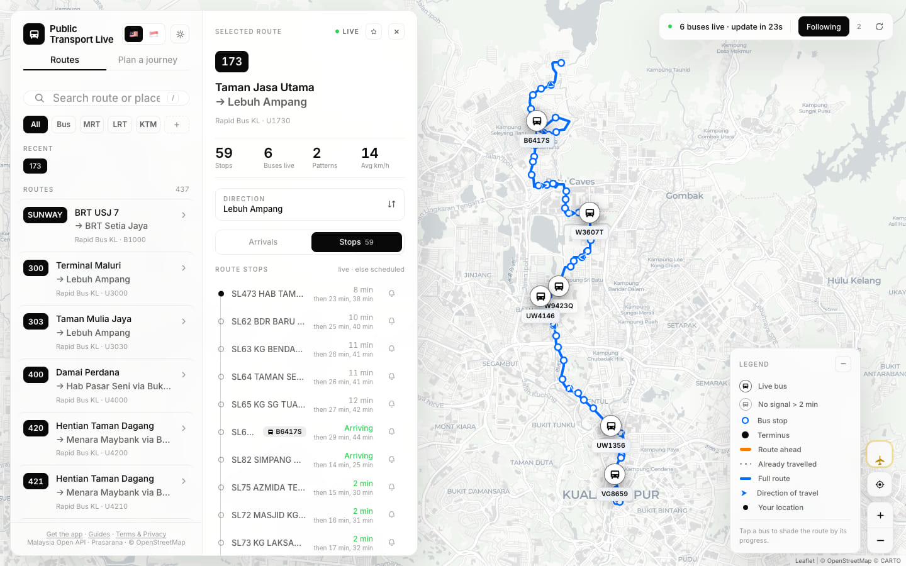
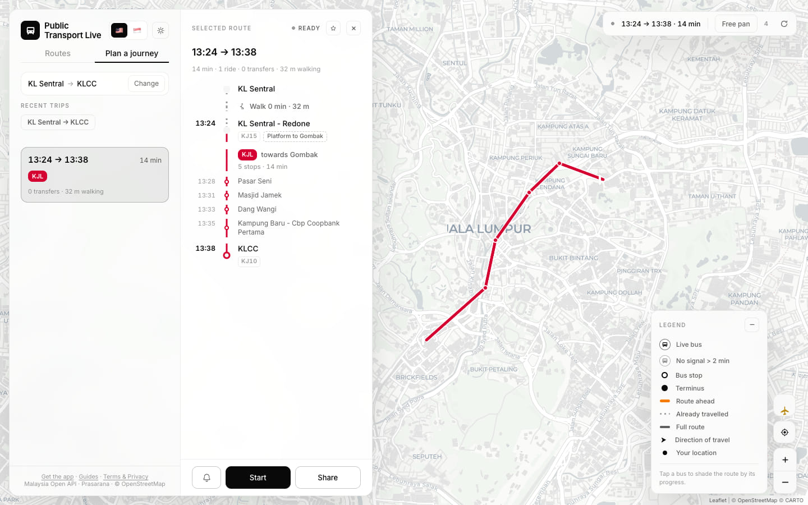
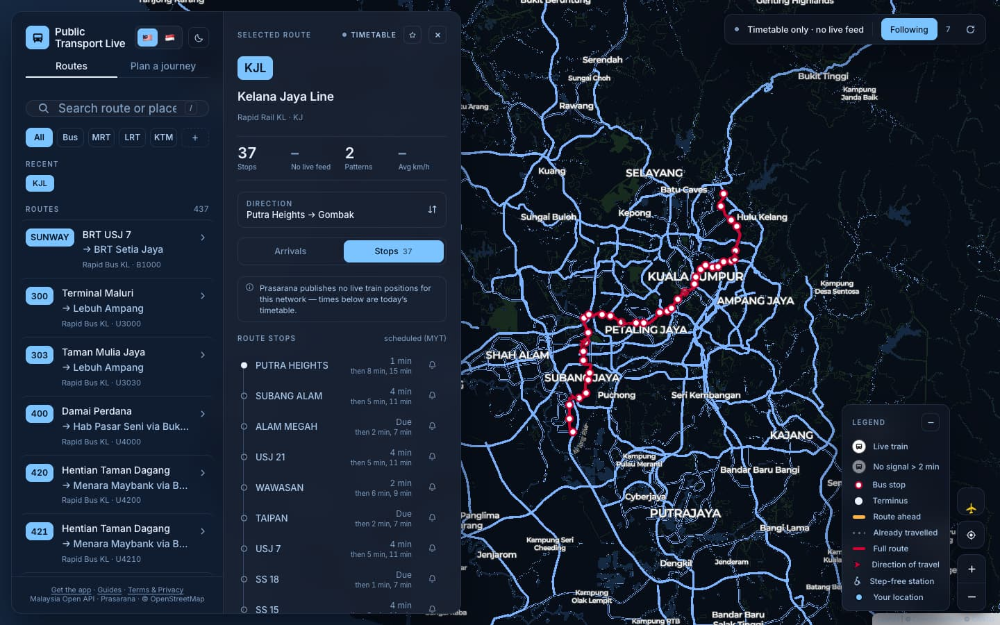
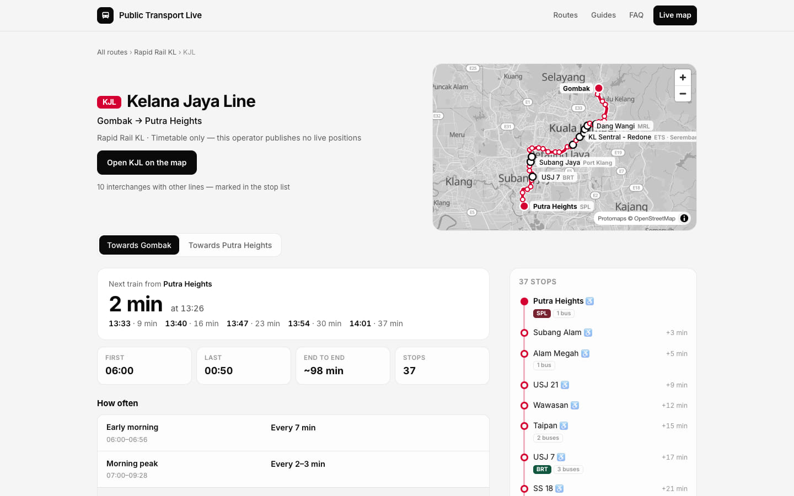
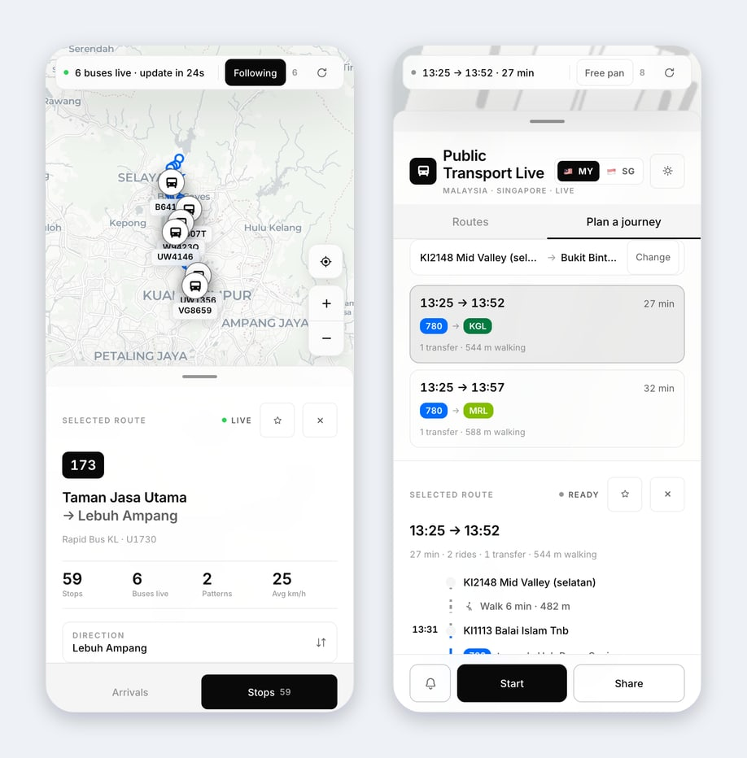
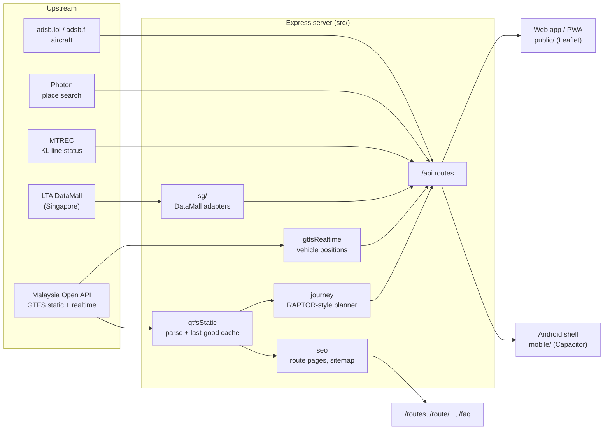
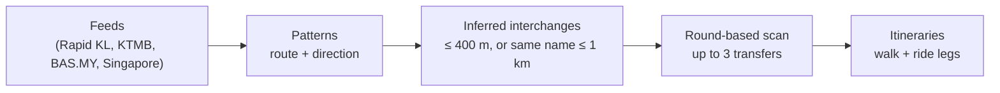

<div align="center">

# Public Transport Live

**Live buses, trains and journey planning for Malaysia and Singapore, built on open GTFS data.**

[](https://www.typescriptlang.org/)
[](https://nodejs.org/)
[](https://expressjs.com/)
[](https://leafletjs.com/)
[](https://capacitorjs.com/)
[](https://gtfs.org/)

[Live site](https://public.kaynx1.com) · [Travel guides](https://travel-guide.kaynx1.com)



</div>

Public Transport Live combines static GTFS timetables with realtime vehicle
positions. It serves a fast, dependency-free web app (also installable as a PWA)
and includes a Capacitor-based Android app. The core Malaysian feeds work
without any credentials.

## Contents

- [Features](#features)
- [Coverage](#coverage)
- [Quick start](#quick-start)
- [Configuration](#configuration)
- [Architecture](#architecture)
- [API endpoints](#api-endpoints)
- [Journey planning](#journey-planning)
- [Platform information](#platform-information)
- [Journey tracking](#journey-tracking)
- [No fares](#no-fares)
- [Android app](#android-app)
- [Self-hosting extras](#self-hosting-extras)
- [Project structure](#project-structure)
- [Testing](#testing)
- [Troubleshooting](#troubleshooting)

## Features

| | |
| --- | --- |
| **Live vehicles.** Bus and train positions where operators publish realtime data, refreshed every 30 seconds while vehicles are running, with direction of travel and a "no signal for over 2 minutes" state. | **Route maps and stop boards.** Each route's shape, stops, service directions and the next departures at every stop. |
| **Journey planner.** Multimodal trips across every network at once, with walking and interchange legs. | **Rail timetables.** Lines without a live feed are shown as timetable-only, with station codes and platform hints. |
| **Nearby and search.** Nearby-stop discovery, stop and route search, and place search for malls, offices and streets. | **Alerts and reminders.** Service disruption banners, and a "remind me" bell that fires 10 and 5 minutes before a vehicle reaches your stop. |
| **Singapore extras.** Bus arrivals and bus load, and live platform crowding on MRT lines (LTA DataMall). | **And more.** Light and dark themes, saved and recent routes, an optional live aircraft overlay, and a protected operations dashboard. |

### Journey planner

Pick any stop, station or place as the start and the end. The planner returns
itineraries with every ride, walk, station code and platform direction, drawn
on the map. Press **Start** to track your progress along the trip.



### Timetable-only rail, in light or dark

Rapid Rail publishes no train positions, so its lines say "Timetable only"
instead of looking like lines with no trains. Departures come from the
headway-based timetable and are shown in the feed's own local time.



### Route pages for search engines

Every route also has a server-rendered landing page (`/route/:feed/:route`)
with the next departures, first and last trains, frequency by time of day and
the full stop list. `/routes`, `/faq` and a dynamic `/sitemap.xml` make the
network crawlable.



### On a phone

On small screens the panel becomes a bottom sheet over the map. The same web app
runs as a PWA and inside the Android shell in [`mobile/`](mobile/).

<p align="center">
  
</p>

## Coverage

`GET /api/rapid-bus/categories` describes every feed, including whether it
carries live vehicles.

| category | network | live vehicles |
| --- | --- | --- |
| `rapid-bus-kl` | Rapid Bus KL | yes |
| `rapid-bus-mrtfeeder` | MRT Feeder buses | yes |
| `rapid-bus-penang` | Rapid Penang | yes |
| `rapid-rail-kl` | LRT Ampang / Sri Petaling / Kelana Jaya, MRT Kajang / Putrajaya, Monorail, BRT | **no** (timetable only) |
| `ktmb` | KTM Komuter (Seremban, Port Klang, Ipoh, Padang Besar) and ETS | yes |
| `mybas-johor`, `mybas-melaka`, `mybas-ipoh`, `mybas-seremban-a`, `mybas-seremban-b`, `mybas-alor-setar`, `mybas-kangar`, `mybas-kota-bharu`, `mybas-kuala-terengganu`, `mybas-kuching` | BAS.MY city bus networks | yes |
| `sg-bus` | Singapore buses (needs `LTA_ACCOUNT_KEY`) | yes (live arrivals) |
| `sg-rail` | Singapore MRT and LRT | **no** (timetable only) |

Malaysian data comes from the [Malaysia Open API](https://developer.data.gov.my/)
(`api.data.gov.my`). Singapore has no GTFS upstream, so `src/sg/` adapts LTA
DataMall and a curated rail network instead.

`rapid-bus-kuantan` is deliberately absent: both of its endpoints return 404,
and the API's own error message no longer lists it.

Feed quirks the code accommodates:

- **Rapid Rail publishes no vehicle positions.** The realtime endpoint returns
  404, so the app presents it as timetable-only rather than as a line with no
  trains. Its schedule is headway-based (`frequencies.txt`), expanded into real
  departures rather than read literally from `stop_times.txt`.
- **KTMB ships no `shapes.txt`**, so a line with no geometry is traced between
  its own stations. The response reports `shapeSource: "stops"` when that
  happens, and the UI says the line is approximate.
- **Realtime speeds are in km/h**, not the metres per second the GTFS-Realtime
  spec requires, so they are converted once, at the edge.
- **An empty or broken upstream never replaces a working timetable.** The last
  good copy of each static feed is kept in `data/gtfs-cache/` and used when the
  upstream fails.

## Quick start

Requires **Node.js 24 or newer** (a locked dependency, `geoip-lite`, needs it).

```bash
npm install
npm run dev
```

Open `http://localhost:3000`. Development binds to `0.0.0.0` by default, so the
site can also be tested from another device on the same network.

For a production-style local run:

```bash
npm run build
npm start
```

| Script | What it does |
| --- | --- |
| `npm run dev` | Runs `src/server.ts` with `tsx watch` |
| `npm run build` | Compiles TypeScript to `dist/` |
| `npm start` | Runs the compiled server (`node dist/server.js`) |
| `npm run check` | Type-checks without emitting |
| `npm run verify` | `check`, then `build` |
| `npm test` | Type-checks the tests, then runs `tests/*.test.ts` with Node's test runner |

On boot the server fetches every static feed and builds the journey network in
the background, so the first journey request does not pay for it.

## Configuration

The core Malaysian feeds work without credentials. Optional features are
enabled with environment variables. A `.env` file in the project root is read at
start-up (real environment variables take precedence), and git ignores it.

| Variable | Purpose |
| --- | --- |
| `PORT` | HTTP port; defaults to `3000` |
| `HOST` | Bind address; use `127.0.0.1` behind a reverse proxy |
| `CORS_ORIGIN` | Allowed web origin; defaults to `*`. The Capacitor app origins are always allowed |
| `LTA_ACCOUNT_KEY` | Singapore LTA DataMall: bus arrivals, vehicles and platform crowding |
| `ADMIN_PASS` | Enables the Basic Auth dashboard at `/my-admin`; without it the dashboard returns 404 |
| `VAPID_PUBLIC`, `VAPID_PRIVATE` | Enables web-push notifications |
| `PUSH_COOLDOWN_HOURS` | Controls notification cooldown |
| `PHOTON_URL` | Place search (Photon geocoder); defaults to the public `photon.komoot.io`. Self-host it with [`photon/`](photon/README.md) |
| `PHOTON_FALLBACK_URL` | Used while `PHOTON_URL` is down; defaults to the public server, `none` disables |
| `ADSENSE_CLIENT`, `ADSENSE_SLOTS` | Ad units on the server-rendered pages; without slots, the ad spots render nothing |

Build-time variables used outside the server:

| Variable | Used by | Purpose |
| --- | --- | --- |
| `RAPIDBUS_API_BASE` | `mobile/` bundler | HTTPS origin of the hosted API that the Android app calls |
| `RAPIDBUS_ALLOW_CLEARTEXT` | `mobile/` bundler | Set to `1` to allow an `http://` API on a private LAN address while debugging |
| `GUIDE_DATA_API` | `blog/build.mjs` | Reads route figures from a local server instead of the live site |

Firebase push for the Android app reads a service-account file, `fcm-key.json`,
from the project root. Git ignores it; without it, push is disabled and
everything else works.

Do not commit production credentials. Supply them through your deployment
environment or a local ignored environment file.

## Architecture



- `src/` holds the TypeScript/Express API, GTFS parsing, routing and realtime adapters.
- `public/` holds the dependency-free web interface and service worker.
- All caches live in process memory. There is no database.
- Rate limits are generous for a person and strict for scripts. The journey
  planner, place search, Singapore vehicles and flights get tighter limits.

## API endpoints

- `GET /health`
- `GET /api/rapid-bus/categories`
- `GET /api/route-index` (every feed's route list in one response)
- `GET /api/rapid-bus/:category/routes?search=T250`
- `GET /api/rapid-bus/:category/routes/:routeId`
- `GET /api/rapid-bus/:category/vehicles?routeId=<route_id>`
- `GET /api/rapid-bus/:category/map?routeId=<route_id>&direction=<index>`
- `GET /api/stops/search?q=<text>&feeds=<a,b>&lat=&lon=` (lat/lon break ties toward the map view)
- `GET /api/stops/nearby?lat=&lon=`
- `GET /api/stops/in-bounds?minLat=&minLon=&maxLat=&maxLon=`
- `GET /api/stops/board?key=<feed:stopId>` (every route calling at one stop, and when)
- `GET /api/places/search?q=<text>&region=my|sg&lat=&lon=` (places that are not stops, from OpenStreetMap)
- `GET /api/journey?fromLat=&fromLon=&toStop=<feed:stopId>` (or `toLat`/`toLon`)
- `GET /api/alerts` (Singapore rail alerts from LTA, Klang Valley line status from MTREC)
- `GET /api/rapid-bus/sg-bus/arrivals?stop=<code>`
- `GET /api/rapid-bus/sg-rail/crowd?line=<code>`
- `GET /api/flights` (optional aircraft overlay)

The map endpoint returns GeoJSON features for route shapes, stops, and live vehicles.

It serves **one direction at a time**. A route's trips are grouped by
`direction_id` into patterns, and `direction` selects which one (default `0`);
the response lists the alternatives under `patterns`. Serving both at once made
a stop's ETA depend on whichever shape happened to match first, so a single
merged list counted down and then back up again.

Stop properties carry `nextDepartures`: the next departures at that stop across
every trip running today, resolved against `calendar.txt`/`calendar_dates.txt`
in the feed's own time zone.

## Journey planning

`GET /api/journey` plans a trip across every configured feed at once, so a
rail-to-rail journey with a bus first mile is one query:

```
/api/journey?fromLat=3.1587&fromLon=101.7137&fromName=KLCC&toStop=rapid-rail-kl:KG14
```

It answers with itineraries made of walk and ride legs, each ride carrying its
board/alight stops, times, intermediate stops and the full stop path so the leg
can be drawn on a map.



How it works, and the honest limits:

- The network is built from PATTERNS (route + direction), each holding its stop
  sequence, per-trip running-time offsets, and trip start times. Headway-based
  rail becomes one offsets array with many starts, so it is exact and cheap.
- Search is a RAPTOR-style round-based scan, up to 3 transfers.
- **Interchanges are inferred.** No Prasarana or KTMB feed ships
  `transfers.txt`, so stops link when they are within 400 m, or share a
  normalised station name within 1 km. A 3-minute penalty covers platform
  changes. Real interchange walking times are not published anywhere in the
  feeds.
- Departures come from today's service calendar in the feed's local time. Rail
  has no vehicle feed, so its plans are timetable-based by definition; bus plans
  are timetable-based too. Live positions refine arrivals on the route view, not
  the plan.
- Feeds are only combined while their clocks agree, and Malaysia and Singapore
  never link: no walking transfer spans the causeway. Rapid Penang is not part
  of the planner.

## Platform information

Platform numbers are **not published in any of these feeds**. `rapid-rail-kl`'s
`stops.txt` has no `platform_code` and no `parent_station`, no station name
mentions a platform, and KTMB ships only `stop_id, stop_name, stop_lat,
stop_lon`. Nothing in the app invents one.

What it shows instead:

- **The station code** (`KJ14`, `KG16`, `AG18`), the code printed on the
  signage. At an interchange this is what makes the change concrete: you arrive
  at Pasar Seni **KJ14** and board at Pasar Seni **KG16**.
- **The platform's destination.** KL rail platforms are signed by where the
  train goes ("Ke Putra Heights"), not by number, so the journey shows
  "Platform to Putra Heights". It is drawn with a dashed outline to mark it as
  inferred from direction rather than read from the feed.
- **Exact platforms and entrances where a feed does carry them**, inside the
  stop name: `KL110 PASAR SENI (PLATFORM F1 - F2)` becomes a solid
  "Platform F1–F2" chip, and `MRT SEMANTAN PINTU B` becomes "Pintu B".

### Where platform numbers could come from, and why they don't

Checked, and ruled out:

- **GTFS feeds**: no `platform_code`, no `parent_station`, no platform text in
  any rail station name.
- **OpenStreetMap**: platform numbers *do* exist (Pasar Seni has ways tagged
  `ref=1`, `ref=2`, `ref=4`), but they are not linked to a line or a direction.
  The Kelana Jaya route relation has 37 `stop` members and **zero** platform
  members, so there is no way to say which number belongs to your train.
- **Moovit**: no platform shown on the screens inspected.

So a number can only come from someone reading the sign, and
[public/platform-overrides.js](public/platform-overrides.js) is generated to
make that as small a job as possible: 761 entries across 335 rail stations,
interchanges first, each already labelled with its line and destination.

```js
window.RAPIDBUS_PLATFORMS = {
  /* ===== INTERCHANGE — wrong platform costs a walk ===== */
  // PASAR SENI  (KJL)
  "rapid-rail-kl:KJ14:KJ:0": "",  // KJL towards Gombak
  "rapid-rail-kl:KJ14:KJ:1": "2", // KJL towards Putra Heights  <- fill these in
};
```

The key is `feed:stopId:routeId:directionId`. The route is part of it because
two lines can share a station and a direction (Alor Setar is served by both the
Padang Besar Line and ETS). Regenerate after a feed update with:

```bash
node scripts-generate-platforms.mjs > public/platform-overrides.js
```

A filled value renders as a **solid** chip ("Platform 2") because it is then a
confirmed fact; a blank one falls back to the **dashed** destination chip, which
is vaguer but never wrong.

## Journey tracking

Selecting an itinerary and pressing **Start** watches the device's position and
answers the two questions you have while travelling: which step am I on, and how
far to the next one. Stops behind you dim, the next one is highlighted with a
live "355 m left" counter, and the floating bar counts down to it. When you come
within 700 m of the stop you must alight at, it fires a notification once: a
local notification in the Android shell, a web notification in a browser.

One mechanism, not two: the get-off alert falls out of the same position watch
that drives the progress display.

Positions are matched against timeline rows that carry coordinates. The timeline
also holds segment rows (the ride and walk descriptions) with none, so stepping
by raw row index would skip the next station and leave nothing marked as
current. That is exactly what happened at the first and last stop before this
was fixed.

**Foreground only.** `@capacitor/geolocation` reports position only while the
app is in the foreground, so tracking works with the app open and does not
survive a locked screen. See [mobile/README.md](mobile/README.md).

## No fares

Moovit shows a fare per leg. That is not reproducible from these feeds: none of
`rapid-bus-kl`, `rapid-rail-kl` or `ktmb` ships `fare_attributes.txt` or
`fare_rules.txt`. All three contain only agency, calendar, routes, shapes,
stop_times, stops and trips (plus frequencies for the Prasarana feeds). Showing
a price would mean inventing one, so the app shows none.

## Android app

`mobile/` holds a Capacitor shell with on-device stop alerts and Firebase push.
See [mobile/README.md](mobile/README.md). It needs a hosted API, your own
Firebase project, and the Android SDK.

```bash
cd mobile
npm install
RAPIDBUS_API_BASE=https://api.yourdomain.com npm run sync
```

## Self-hosting extras

- **Place search.** [`photon/`](photon/README.md) builds a Photon geocoder
  holding Malaysia and Singapore only, with Docker Compose. Point `PHOTON_URL`
  at it.
- **Basemap for route pages.** The `/route/...` pages draw their maps with
  MapLibre over a self-hosted Protomaps PMTiles extract of OpenStreetMap. See
  [docs/basemap.md](docs/basemap.md) to rebuild it.
- **Travel guides.** [`blog/`](blog/) is a zero-dependency static site builder
  (`node blog/build.mjs`) for the travel guides. It writes to `blog/dist/`.

## Project structure

```
.
├── src/                     Express server (TypeScript)
│   ├── server.ts            App setup, security headers, rate limits, admin dashboard
│   ├── routes.ts            /api endpoints
│   ├── config.ts            Feed definitions and .env loader
│   ├── gtfsStatic.ts        Static GTFS download, parsing and last-good cache
│   ├── gtfsRealtime.ts      GTFS-Realtime vehicle positions
│   ├── schedule.ts          Service calendars and next departures
│   ├── journey.ts           Journey planner
│   ├── search.ts            Route and stop search
│   ├── places.ts            Photon place search
│   ├── seo.ts               Route pages, FAQ, sitemap
│   ├── mtrec.ts             Klang Valley line status
│   ├── flights.ts           Aircraft overlay
│   ├── push.ts, webpush.ts  Firebase and web push
│   ├── providers/           Per-feed time zone and speed normalisation
│   └── sg/                  Singapore (LTA DataMall) adapters
├── public/                  Web app: index.html, app.js, styles.css, sw.js, vendored Leaflet
├── mobile/                  Capacitor Android shell
├── photon/                  Self-hosted geocoder (Docker)
├── blog/                    Travel-guide static site builder
├── design/                  UI references and design notes
├── docs/                    Basemap notes and README images
├── tests/                   Node test runner suites
└── scripts-generate-platforms.mjs
```

## Testing

```bash
npm test
```

The suites cover feed parsing, service days, per-feed clocks, translated and
romanised stop names, and abnormal or hostile input. Fixtures are small
in-memory zips, not live provider data, so the tests run offline. A few cases
are marked `todo` to document known defects without failing the run.

## Troubleshooting

| Symptom | Cause and fix |
| --- | --- |
| Singapore buses are missing, or Singapore endpoints return 503 | `LTA_ACCOUNT_KEY` is not set. Singapore rail works without it. |
| `/my-admin` returns 404 | The dashboard stays off until `ADMIN_PASS` is set. |
| The first journey right after start-up is slow | The journey network is still being built in the background. Give it a few seconds. |
| A network's routes disappear | Its upstream is failing. The last good feed in `data/gtfs-cache/` is used if one was saved earlier. |
| Edits to `public/` don't show up in the browser | An old service worker may still be serving its cache. Hard-reload, or unregister it in DevTools. |
| Place search returns nothing | The Photon server is unreachable. Check `PHOTON_URL` and `PHOTON_FALLBACK_URL`. |
| `npm install` prints `EBADENGINE` warnings | The locked dependencies declare Node.js 24 or newer (`geoip-lite`) and 22 or newer (`firebase-admin`). Upgrade Node. |
